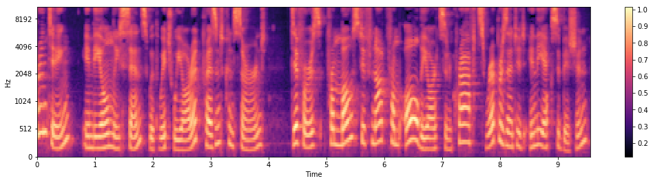

# Audio Processing, Step by Step

Hands-on notebooks for understanding waveforms, Fourier analysis, spectrograms, and the inputs used by audio-generation models.

[Learning path](#learning-path) · [Audio analysis](analysis.ipynb) · [Lecture slides](deep%20learning%20for%20audio%20processing.pdf)

*A speech signal in the time–frequency domain: the mel-spectrogram saved in [analysis.ipynb](analysis.ipynb).*

## Learning path

| Step | Notebook | What you explore |
| --- | --- | --- |
| 1 | [Trigonometry](trigonometry.ipynb) | The sinusoidal functions behind Fourier analysis |
| 2 | [Signal synthesis](synthesis.ipynb) | Combining sine waves to form sawtooth and square waves |
| 3 | [Audio analysis](analysis.ipynb) | DFT with sine/cosine and complex exponentials, STFT, and mel-spectrograms |
| 4 | [Waveform preprocessing](audio-processing-wave.ipynb) | Loading audio with librosa, normalization, quantization, and μ-law encoding |
| 5 | [GRU waveform generation](Simple%20RNN%20prediction%20model.ipynb) | A recurrent model for predicting audio samples |
| 6 | [Naive WaveNet](Naive%20wavenet%20model.ipynb) | Waveform generation using dilated convolutions |

## Getting started

Open the notebooks in Jupyter. Begin with trigonometry and signal synthesis, then move to analysis with a speech recording.

For the audio examples, prepare **LJSpeech-1.1** and update `data_dir` to your local `wavs` directory. Audio files are not included. The analysis notebooks use NumPy, SciPy, Matplotlib, librosa, and IPython audio playback.

The GRU and WaveNet notebooks use **TensorFlow 1.x graph/session APIs**, including `tf.placeholder` and `tf.Session`. They require a matching legacy environment or a separate code migration; they are not directly compatible with an unmodified TensorFlow 2 installation.

## Background

The [lecture slides](deep%20learning%20for%20audio%20processing.pdf) introduce deep-learning models for audio. The WaveNet notebook references *WaveNet: A Generative Model for Raw Audio* and retains the associated diagrams and source reference. The README preview is an existing notebook output.
